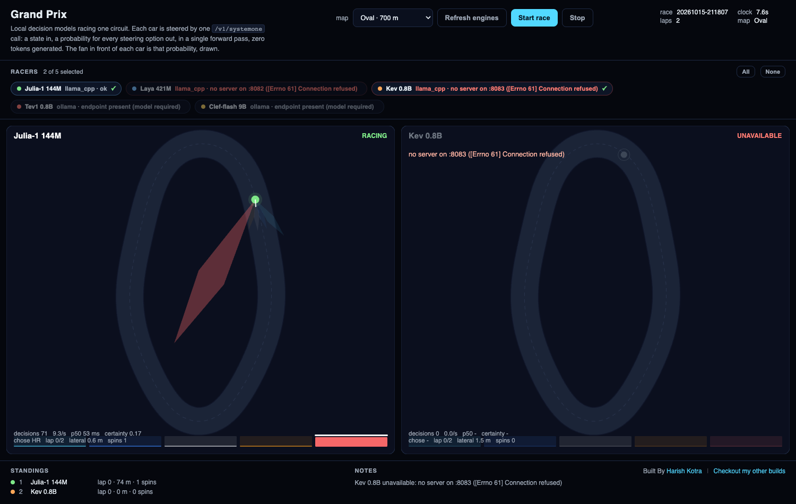
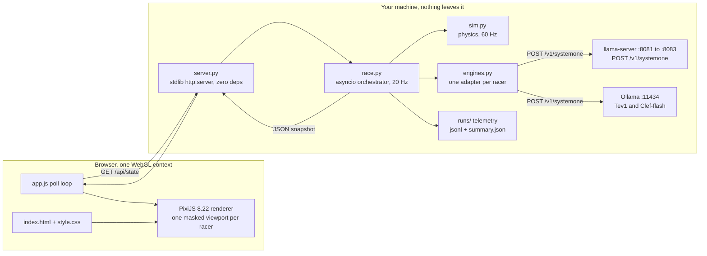
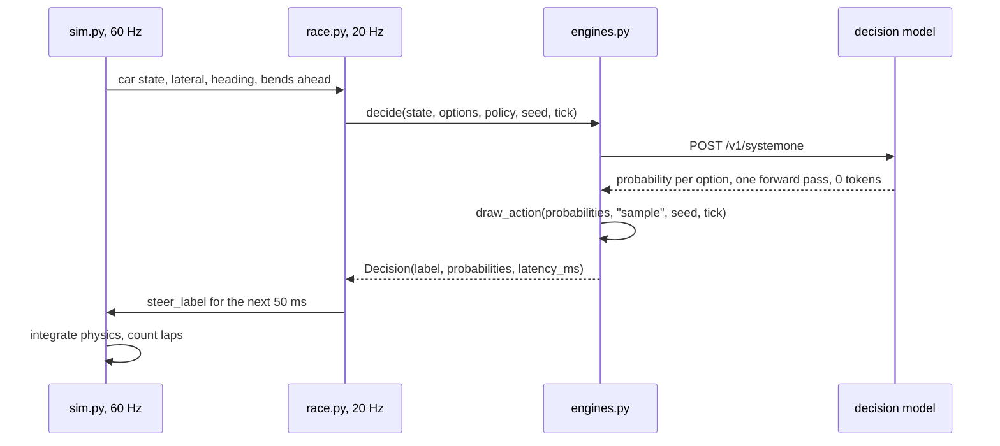

# AI Grand Prix

> Five small decision models race the same car on the same track, on your laptop, with no cloud, no API keys and no tokens generated.





## What this is

AI Grand Prix is a race between small open-weight **decision models**. Each model drives its own car on the same circuit, and every steering move you see on screen is a real prediction from a model running on your machine.

It is not a chatbot demo. The models never write a sentence. Twenty times a second, each one is handed a small JSON state (where the car is, how far off the centre line, its heading, its speed, its lap, its place, and the shape of the road ahead) and returns a probability for each of five steering options in a single forward pass. The car then drives the option that was drawn from that distribution.

The interesting part is not who wins. It is that you can **watch a model's belief**: a translucent fan called the belief cone is drawn out of every car, one wedge per option, sized by the probability the model just returned. When a car runs wide on a corner, you watched it choose the less likely move.

## Why it exists

A decision model is the part of the AI stack almost nobody has seen work. Chat models get the demos. The small models that actually pick an option, on a deadline, on device, are invisible.

This project makes them visible in about ten seconds:

- **It shows what a chat model cannot do.** One pass, no generation, a calibrated distribution over options you supplied, roughly 17 ms on a 144M model. No prompt engineering, no output parsing, no refusal path.
- **It is honest about uncertainty.** The car drives the sampled option, not the most likely one. You will see a model take the 40 percent move and clip an apex. That is a real uncertain decision, not a lookup table.
- **It runs offline.** No network at any point after the models are downloaded. Conference wifi can fail and the demo still works.
- **It is a game, not a benchmark.** Same physics for everyone, so differences you see are differences in the models. No leaderboard, no accuracy claim.

## Quickstart

Two commands, no dependencies to install first. The offline replay needs no models at all, so you can confirm the project is intact before any download:

```bash
git clone https://github.com/harishkotra/grand-prix.git
cd grand-prix

python3 tests/run_all.py     # expect FAILURES: 0 across 35 tests, no network needed
./run.sh --replay            # two synthetic racers, watch the board work
```

Then, to race real models, bring the engines up and start the dashboard:

```bash
./tools/engines_up.sh        # first run downloads about 13 GB (2.2 GB with SKIP_CLEF=1)
./run.sh                     # then pick your models and map on the page, press Start
```

`./run.sh` opens `http://127.0.0.1:8078/`. Nothing races until you press **Start race**.

Full setup, including the Ollama path for Clef-flash and the memory budget, is in [SETUP.md](SETUP.md).

## What you see

**Top bar.** Race ID, running clock, lap count, the current map, a **Refresh engines** button that re-probes which models are alive, and **Start / Stop**.

**Racer chips.** One chip per model with a counter such as `2 of 5 selected`, plus All and None. The board draws exactly the racers you select. Nothing is on the track that you did not ask for, and there are no synthetic racers in the field.

**Map picker.** Five circuits with their lengths, from a 900 m speedway to a 700 m hairpin. Different tracks, different winners.

**One panel per racer.** This is where the work shows:

| Element | What it means |
|---|---|
| Status badge | `RACING`, `FROZEN`, or `UNAVAILABLE` |
| Belief cone | One wedge per option, drawn out of the car, its size set by the probability returned |
| Steering gauge | Five bars, one per option, the chosen one capped in white |
| Stats line | `decisions`, `decisions/s`, `p50`, `certainty`, `chose`, `lap`, `lateral`, `spins` |

**Standings column.** Place, model, laps, and finish time once a car crosses the line.

If an engine is not answering, its panel greys out and says `UNAVAILABLE` with the reason. **It never fabricates a move.** A dead model sits still rather than pretending.

## How a decision actually works

### 1. The five options are a fixed list

A racer never invents an action. The option set is a module level constant in [sim.py](sim.py):

```python
STEER_BUCKETS: tuple[tuple[str, float, str], ...] = (
    ("hard_left", -0.036, "Steer hard left: a firm left arc, about a 28 m radius."),
    ("left", -0.018, "Steer left: a gentle left arc, about a 55 m radius."),
    ("straight", 0.0, "Hold the wheel straight: no steering input."),
    ("right", 0.018, "Steer right: a gentle right arc, about a 55 m radius."),
    ("hard_right", 0.036, "Steer hard right: a firm right arc, about a 28 m radius."),
)
BUCKET_K = {label: k for label, k, _ in STEER_BUCKETS}
```

Each option carries a description, because that description is sent to the model as the option's criterion. The model is choosing between described options, not between letters.

### 2. The question is one POST

The wire contract is llama.cpp's native `POST /v1/systemone`. [engines.py](engines.py) builds the body:

```python
def question_body(state, question_id, instructions, options, model=None):
    """The request half of the contract. `criteria` must be label -> description."""
    body = {
        "state": state,
        "questions": {
            question_id: {
                "type": "choice",
                "instructions": instructions,
                "criteria": {option.label: option.description for option in options},
            }
        },
    }
    if model is not None:
        body["model"] = model
    return body
```

The instructions are fixed in [race.py](race.py):

```python
QUESTION_ID = "steer"
INSTRUCTIONS = (
    "You are steering a race car on a closed circuit. Choose the steering action for the "
    "next 50 milliseconds. Stay close to the centre line, stay on the track, and complete "
    "the laps as fast as you can. Options run from hard left to hard right."
)
OPTIONS = tuple(Option(label, description) for label, _, description in STEER_BUCKETS)
```

### 3. The state is the model's whole world

[sim.py](sim.py) builds it. There is no hidden context and no prompt history:

```python
return {
    "task": "steer",
    "track": {
        "width_m": round(self.track.half_width * 2, 1),
        "bends_ahead": bends,
    },
    "car": {
        "lateral_m": round(car.lateral, 2),
        "side": "right of centre" if car.lateral > 0 else "left of centre",
        "heading_error_deg": round(math.degrees(car.heading_error), 1),
        "speed_mps": round(car.speed, 1),
        "lap": car.lap,
        "laps_total": self.laps,
        "off_track_ticks": car.off_ticks,
        "spins": car.spins,
        "position": place,
        "cars_total": len(self.cars),
        "gap_to_leader_m": round(max(0.0, leader.distance_m - car.distance_m), 1),
    },
    "goal": (
        f"Hold within 5 m of the centre line at {BASE_SPEED_MPS:.0f} m/s, stay on a "
        f"{self.track.half_width * 2:.0f} m wide circuit, and finish {self.laps} laps "
        f"ahead of the other cars."
    ),
}
```

### 4. We sample, we do not take the max

This is a deliberate choice and it is the reason the race is watchable. From [engines.py](engines.py):

```python
def draw_action(probabilities, policy, seed, tick):
    """Pick one option. `sample` draws from the distribution; `argmax` takes the top.

    Sampling is seeded per (racer, tick) so the same race replays identically.
    """
    if policy == "argmax":
        return max(probabilities.items(), key=lambda item: item[1])[0]
    ...
```

With `policy: "sample"` the car sometimes takes the second most likely option, which is exactly what an uncertain decision looks like. Set `policy: "argmax"` in `config.json` to watch a perfectly obedient field instead, and the personality of every racer disappears.

### 5. Decisions are decoupled from the render loop

`p50` is around 17 ms but the slowest decision measured on an M1 Pro was 861 ms. Tying a decision to the frame would make the whole board stutter. So:

- the physics and the renderer run at **60 Hz** (`sim_hz`)
- each racer is asked for a decision at **20 Hz** (`tick_hz`)
- a decision in flight does not block the frame, and the car keeps its last steering input until the next one lands

### 6. Laps are earned, not handed out

The first version of this had a bug worth keeping in the README, because it is the kind of thing a simulator gets wrong quietly. Cars were placed just behind the start line, so the first tick crossed it and a car was credited a lap after 13.5 m. The fix is in [sim.py](sim.py): the grid starts **past** the line, and a lap only counts after most of a circuit of real travel.

```python
car.since_lap_m += travelled
crossed_line = previous_s > 0.75 * self.track.length and self.track.s_at(index) < 0.25 * self.track.length
if crossed_line and car.since_lap_m >= LAP_MIN_TRAVEL * self.track.length:
    car.lap += 1
    car.since_lap_m = 0.0
```

Travel is also unwrapped rather than taken modulo, so a small backward step cannot read as almost a full lap. A regression test drives a car backwards to prove it earns nothing.

### 7. The belief cone is drawn straight from the distribution

No smoothing, no exaggeration. From [static/app.js](static/app.js):

```js
for (const label of STEER_ORDER) {
  const p = probabilities[label] ?? 0;
  const angle = this.heading + (STEER_ANGLE[label] * Math.PI) / 180;
  const length = reach * (0.32 + 1.5 * p);
  ...
  cone
    .poly([this.pos[0], this.pos[1], leftX, leftY, tipX, tipY, rightX, rightY])
    .fill({ color: STEER_COLOR[label], alpha: 0.07 + 0.30 * p });
}
```

## Architecture



One decision, end to end:



### Ports

| Port | Owner |
|---|---|
| 8078 | the dashboard and the gateway (`./run.sh`) |
| 8081 | llama-server, Julia-1 144M |
| 8082 | llama-server, Laya 421M |
| 8083 | llama-server, Kev 0.8B |
| 11434 | Ollama, which serves Tev1 and Clef-flash |
| 8085 | Clef-flash, only if you run the Q4_K_M GGUF directly |

## Tech stack

| Layer | Choice | Why this one |
|---|---|---|
| Renderer | PixiJS 8.22 (MIT, vendored, 824 KB) | Five racer panels share **one** WebGL context as masked viewports. Five separate canvases would mean five GPU contexts on a laptop, which is the wrong trade. PixiJS is a renderer, not an engine, and the interesting drawing here is custom. |
| Inference | llama.cpp (MIT) | Serves `/v1/systemone` natively. No option cap, no prompt, no output tokens. |
| Second engine | Ollama 0.35.1+ | Same contract with an explicit model field, and the only practical way to load an 11 GB 9B model here. |
| Gateway | Python stdlib `http.server` | Not FastAPI, not Flask. The point is that a fresh clone runs with nothing installed. |
| Concurrency | `asyncio` plus `asyncio.to_thread` | Decisions are blocking HTTP calls, so they run off the loop and never block a frame. |
| Tests | stdlib `unittest` plus a local mock server | 35 tests, no network, no models, no pytest to install. |
| Front end | Plain ES modules, no bundler | One HTML file, one CSS file, one JS file. Nothing to build before running. |

Total project code is about 3,950 lines across Python, JS, CSS, HTML and shell.

## The racers

Five open-weight models. Sizes and licenses are as published; latency is what `tools/probe_engines.py` measured on an M1 Pro.

| Racer | Params | Served by | License | Latency measured |
|---|---|---|---|---|
| Julia-1 144M | 144M | llama.cpp, `:8081` | Apache-2.0 | 18 to 32 ms |
| Laya 421M | 421M | llama.cpp, `:8082` | Apache-2.0 | 81 to 91 ms |
| Kev 0.8B | 812 MB Q8 | llama.cpp, `:8083` | Apache-2.0 | 157 to 184 ms |
| Tev1 0.8B | 752 MB | Ollama, `:11434` | being finalised by the publisher | 10 to 861 ms |
| Clef-flash 9B | 11 GB | Ollama, `:11434` | Apache-2.0 | first call is a model load |

Racers are declared in `config.json`. Add one by adding an entry; the dashboard, the chips and the panels are all driven from that file.

## The maps

| Map | Length | Width | Reference lap |
|---|---|---|---|
| Circuit | 700 m | 31 m | 48.7 s |
| Speedway | 900 m | 48 m | 62.9 s |
| Switchback | 750 m | 33 m | 52.3 s |
| Hairpin | 700 m | 29 m | 48.9 s |
| Oval | 700 m | 34 m | 48.8 s |

`python3 tools/diagnose_track.py` measures every generated circuit and **fails if any corner is tighter than the sharpest steering option** (27.8 m). That check exists because an early map set produced 1 m corners that no model could drive, and it looked like the models were broken.

## Repo layout

```
grand-prix/
├── engines.py            engine adapters, one per racer type, and the sampling policy
├── sim.py                track builder, physics, state builder, lap counting
├── race.py               asyncio orchestrator, telemetry, racer retirement
├── server.py             stdlib HTTP gateway and API
├── config.json           the race settings and the racer list
├── run.sh                dashboard launcher
├── static/
│   ├── index.html        the whole UI shell
│   ├── app.js            PixiJS scene, belief cone, gauges, polling
│   ├── style.css         layout
│   └── vendor/pixi.min.mjs   the vendored renderer, tracked on purpose
├── tests/                35 tests, offline, no models needed
├── tools/
│   ├── engines_up.sh     idempotent startup, prints the failing log tail
│   ├── engines_down.sh   stops only what it started, via pidfiles
│   ├── probe_engines.py  asks every engine for a real decision
│   ├── run_headless.py   a full race with no browser
│   ├── diagnose_track.py proves every map is drivable
│   ├── gguf_meta.py      reads GGUF metadata, says if it is a decision model
│   └── vendor_pixi.sh    re-vendors the renderer from node_modules
├── content/              blog post, X thread, LinkedIn post
├── results/              screenshots used in this README
├── SETUP.md              setup notes, including the 8 GB host case
├── M1-PRO.md             the runbook for the M1 Pro
└── LICENSE               MIT for the code, model licenses stay with the models
```

## Honest notes

- **This is a showcase, not a benchmark.** Nothing here claims a model is better at driving in general. Same physics, same options, same seed, one narrow task.
- **Latency is measured, not estimated.** `tools/probe_engines.py` prints the real distribution each engine returned, and the panel shows `p50` from the live race.
- **An unavailable engine freezes its car.** It is never asked to guess and it never answers on another model's behalf.
- **No model weights are in this repo.** They are downloaded by `tools/engines_up.sh` into your own cache.

## Fork it and contribute

This project is deliberately small and boring in the places that matter, so a fork is a weekend, not a rewrite. Everything below is real and pickable.

**Set up a fork**

```bash
git clone <your-fork>
cd grand-prix
python3 tests/run_all.py     # green before you touch anything
./run.sh --replay            # see the board with no models
```

The test suite needs no network and no models, which is the whole reason it is first in the quickstart. Write the failing test before the feature.

**Small, a few hours each**

- **A sixth steering option.** Add a bucket to `STEER_BUCKETS`, add its colour and angle to `STEER_ORDER`, `STEER_ANGLE` and `STEER_COLOR` in `app.js`, then run `tools/diagnose_track.py` because a tighter option changes which corners are drivable.
- **A new map.** Add a preset to `TRACK_PRESETS` in `sim.py`, then run `tools/diagnose_track.py`. It fails the build if a corner is tighter than the sharpest steering option, which is the trap that ate a whole afternoon here.
- **Pause and step.** The gateway already holds the whole race state, so a `pause` command next to `start` is mostly bookkeeping.
- **Export a GIF or a clip.** Telemetry is already a `jsonl` per race, so a headless re-render is a script, not a feature.
- **Argmax versus sample in the UI.** The policy is already a config value. Expose it as a toggle and let people watch the same seed become a different race.

**Medium, a weekend**

- **Per-racer speed limits.** Right now every car has the same physics, so a fast model and a slow model differ only in decisions. Giving each racer its own top speed turns latency into a visible handicap.
- **A lap time chart under each panel.** All the data is in `runs/*.jsonl`. A sparkline of lap times would make "this model is consistent" or "this model is erratic" obvious at a glance.
- **A decision log view.** Click a car and see the last twenty decisions: state in, distribution out, option taken, latency. This is the teaching view, and the telemetry already records all of it.
- **Two track maps instead of one.** `bends_ahead` is already in the state, so an opponent's position is a small extension.

**Larger, worth a proper issue first**

- **A new task behind the same engine.** The steering buckets are just a list of choices and the sim is just the consequence. Swap both and you have a drone landing pad, a trading bot or a traffic simulator with the same belief cone, the same telemetry and the same tests.
- **A second renderer path.** PixiJS was chosen for one WebGL context. A WebGPU path would be interesting and is a real project.
- **Multi-machine racing.** The engines are HTTP endpoints, so a race across two laptops is a config change plus a transport question.

**Ground rules**

1. `python3 tests/run_all.py` must be green. It needs no models, so there is no excuse.
2. New behaviour gets a regression test. Two of the bugs in this repo were silent and only caught by a test that drives a car backwards.
3. Do not add a dependency the quickstart would need. Stdlib Python and a vendored renderer is a feature.
4. Never let an unavailable engine produce a plausible answer. Freeze the car and say why.
5. Prose in docs and content uses no em dashes or en dashes. Grep before you commit.
